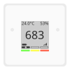

## About Aranet4

* SAF Tehnika [Aranet4](https://aranet.com/products/aranet4/) are indoor air quality monitors
* Has sensors to relay CO2, temperature, humidity and atmospheric pressure
* Uses Bluetooth Low Energy (BLE) and has a limited range
* 2x AA batteries are used as power source

## Features

* Read current sensor values
* CO2 measurement (NDIR sensor)
* Temperature, humidity and atmospheric pressure
* Battery level
* Configurable measurement interval
* Historical values stored on the device

## Protocol

The device uses BLE GATT for communication.  
Sensor values are immediately available for reading, and only need a simple scaling.  

Starting with firmware 1.2.0, the sensor characteristics are only readable once the device has been paired,
unless the "Smart Home integration" setting has been enabled on the device itself.
The same setting enables the [advertisement data](#advertisement-data), which carries the measurements without any connection.

### BLE & GATT

The basic technologies behind the sensors communication are [Bluetooth Low Energy (BLE)](https://en.wikipedia.org/wiki/Bluetooth_Low_Energy) and [GATT](https://www.bluetooth.com/specifications/gatt).
They allow the devices and the app to share data in a defined manner and define the way you can discover the devices and their services.
In general you have to know about services and characteristics to talk to a BLE device.

### Data structure

The data is encoded in little-endian byte order.  
This means that the data is represented with the least significant byte first.  

To understand multi-byte integer representation, you can read the [endianness](https://en.wikipedia.org/wiki/Endianness) Wikipedia page.

## Identifying the device

The advertised name is `Aranet4 XXXXX`, `Aranet4` followed by the serial number suffix of the device.

When "Smart Home integration" is enabled, the device also advertises manufacturer data with the SAF Tehnika
company identifier `0x0702`. Unlike the other Aranet models, the Aranet4 payload has no device type byte,
see [Advertisement data](#advertisement-data).

## Advertisement data

When "Smart Home integration" is enabled, the device broadcasts manufacturer specific data with the SAF Tehnika company identifier `0x0702`.

The payload is 22 bytes:

| Bytes | Type       | Conversion   | Description                     |
| ----- | ---------- | ------------ | ------------------------------- |
| 00    | uint8      | -            | status flags, see below         |
| 01    | uint8      | -            | firmware version, patch         |
| 02    | uint8      | -            | firmware version, minor         |
| 03    | uint8      | -            | firmware version, major         |
| 04-07 | bytes      | -            | unknown                         |
| 08-09 | uint16_le  | -            | CO2 (ppm)                       |
| 10-11 | uint16_le  | / 20         | temperature (°C)                |
| 12-13 | uint16_le  | / 10         | atmospheric pressure (hPa)      |
| 14    | uint8      | -            | humidity (% RH)                 |
| 15    | uint8      | -            | battery level (%)               |
| 16    | uint8      | -            | status color                    |
| 17-18 | uint16_le  | -            | measurement interval (seconds)  |
| 19-20 | uint16_le  | -            | age of the measurement (seconds)|
| 21    | uint8      | -            | advertisement counter           |

The measurements are in the same order as in the [current readings](#reading-current-values) (`f0cd3001`), and the same [invalid value](#invalid-values) flags apply.
Unlike the other Aranet models, the payload does not begin with a device type byte, it starts directly with the status flags.

Status flags:

| Bit   | Description                                              |
| ----- | -------------------------------------------------------- |
| 0     | device is disconnected                                   |
| 2-3   | calibration state (0 not active, 1 end request, 2 in progress, 3 error) |
| 4     | DFU (firmware update) active                             |
| 5     | smart home integration enabled                           |

If bit 5 is not set, the advertisement carries no measurement, and stops after the version bytes.

## Services and characteristics

| Service               | UUID                                   | Purpose                                  |
| --------------------- | -------------------------------------- | ---------------------------------------- |
| Generic access        | `1800`                                 | device name                              |
| Device information    | `180a`                                 | model, serial number, versions           |
| Battery               | `180f`                                 | battery level                            |
| Aranet                | `fce0` or `f0cd1400`                   | measurements, history, commands          |

##### Generic access (UUID 00001800-0000-1000-8000-00805f9b34fb)

| Characteristic UUID                  | Access      | Type       | Description                     |
| ------------------------------------ | ----------- | ---------- | ------------------------------- |
| 00002a00-0000-1000-8000-00805f9b34fb | read        | ASCII      | device name                     |

##### Device information (UUID 0000180a-0000-1000-8000-00805f9b34fb)

| Characteristic UUID                  | Access      | Type       | Description                     |
| ------------------------------------ | ----------- | ---------- | ------------------------------- |
| 00002a24-0000-1000-8000-00805f9b34fb | read        | ASCII      | model number                    |
| 00002a25-0000-1000-8000-00805f9b34fb | read        | ASCII      | serial number                   |
| 00002a26-0000-1000-8000-00805f9b34fb | read        | ASCII      | firmware revision (current)     |
| 00002a27-0000-1000-8000-00805f9b34fb | read        | ASCII      | hardware revision               |
| 00002a28-0000-1000-8000-00805f9b34fb | read        | ASCII      | software revision (factory)     |
| 00002a29-0000-1000-8000-00805f9b34fb | read        | ASCII      | manufacturer name               |

The current firmware version is the one from `2a26`, `2a28` holds the version the device shipped with.

##### Battery service (UUID 0000180f-0000-1000-8000-00805f9b34fb)

| Characteristic UUID                  | Access      | Type       | Description                     |
| ------------------------------------ | ----------- | ---------- | ------------------------------- |
| 00002a19-0000-1000-8000-00805f9b34fb | read        | uint8      | battery level (%)               |

##### Aranet service (UUID 0000fce0-0000-1000-8000-00805f9b34fb)

Starting with firmware 1.2.0, the service is identified by the 16 bits UUID `0xfce0`.
Devices running an older firmware expose it as `f0cd1400-95da-4f4b-9ac8-aa55d312af0c` instead.
The characteristics are the same in both cases, so look for either UUID.

| Characteristic UUID                  | Access      | Type       | Description                                  |
| ------------------------------------ | ----------- | ---------- | -------------------------------------------- |
| f0cd1401-95da-4f4b-9ac8-aa55d312af0c | read        | bytes      | sensor settings state                        |
| f0cd1402-95da-4f4b-9ac8-aa55d312af0c | write       | bytes      | commands, see [Commands](#commands)          |
| f0cd1502-95da-4f4b-9ac8-aa55d312af0c | read        | bytes      | sensor calibration data                      |
| f0cd1503-95da-4f4b-9ac8-aa55d312af0c | read        | 9 bytes    | current readings                             |
| f0cd3001-95da-4f4b-9ac8-aa55d312af0c | read        | 13 bytes   | current readings + interval + age            |
| f0cd2001-95da-4f4b-9ac8-aa55d312af0c | read        | uint16_le  | total readings in memory                     |
| f0cd2002-95da-4f4b-9ac8-aa55d312af0c | read        | uint16_le  | measurement interval (seconds)               |
| f0cd2003-95da-4f4b-9ac8-aa55d312af0c | notify      | bytes      | history readings (v1)                        |
| f0cd2004-95da-4f4b-9ac8-aa55d312af0c | read        | uint16_le  | seconds since last measurement               |
| f0cd2005-95da-4f4b-9ac8-aa55d312af0c | read        | bytes      | history readings (v2)                        |

The Aranet4 is the only Aranet model to use `f0cd1503` / `f0cd3001`, the other models use `f0cd1504` with a different layout.

## Reading current values

When "Smart Home integration" is enabled, the same measurements are also available without connecting,
see [Advertisement data](#advertisement-data).

Read `f0cd3001`. It returns 13 bytes, the first 9 of which are identical to `f0cd1503`:

| Bytes | Type       | Conversion   | Description                     |
| ----- | ---------- | ------------ | ------------------------------- |
| 00-01 | uint16_le  | -            | CO2 (ppm)                       |
| 02-03 | uint16_le  | / 20         | temperature (°C)                |
| 04-05 | uint16_le  | / 10         | atmospheric pressure (hPa)      |
| 06    | uint8      | -            | humidity (% RH)                 |
| 07    | uint8      | -            | battery level (%)               |
| 08    | uint8      | -            | status color, see below         |
| 09-10 | uint16_le  | -            | measurement interval (seconds)  |
| 11-12 | uint16_le  | -            | age of the measurement (seconds)|

Example:

```
30 02 ba 01 94 27 2d 62 01 2c 01 2a 00
```

| Field       | Raw     | Value              |
| ----------- | ------- | ------------------ |
| CO2         | `0230`  | 560 ppm            |
| temperature | `01ba`  | 442 / 20 = 22.1 °C |
| pressure    | `2794`  | 10132 / 10 = 1013.2 hPa |
| humidity    | `2d`    | 45 %               |
| battery     | `62`    | 98 %               |
| status      | `01`    | green              |
| interval    | `012c`  | 300 s              |
| age         | `002a`  | 42 s               |

The measurement was taken `age` seconds ago, so its timestamp is `now - age`.
If `age` is greater than `interval`, the two are out of sync: use the current time instead.

Status color:

| Value | Status color |
| ----- | ------------ |
| 0     | error        |
| 1     | green        |
| 2     | yellow       |
| 3     | red          |

### Invalid values

While the sensor is warming up, or while a CO2 calibration is in progress, the device does not take new measurements
and stores magic numbers instead. Each value has an out-of-range flag bit:

| Value       | Invalid when   |
| ----------- | -------------- |
| CO2         | bit 15 is set  |
| temperature | bit 14 is set  |
| pressure    | bit 15 is set  |

The flag bit is *not* the same for every value. When it is set, discard the whole reading: do not mask the bit off and use the rest of the value.

## Historical values

The device stores its measurements, and the history is downloaded one parameter at a time.
Two protocols exist: devices exposing `f0cd2005` use the poll based "v2" protocol, older ones use the notification based "v1" protocol.

| Parameter             | Id     | Datapoint  | Conversion |
| --------------------- | ------ | ---------- | ---------- |
| temperature           | `0x01` | uint16_le  | / 20       |
| humidity              | `0x02` | uint8      | -          |
| atmospheric pressure  | `0x03` | uint16_le  | / 10       |
| CO2                   | `0x04` | uint16_le  | -          |

Indices start at 1, and the number of stored readings is given by `f0cd2001`.
Datapoint `i` was measured at:

```
timestamp(i) = now - age - (total_readings - i) * interval
```

with `age` from `f0cd2004` and `interval` from `f0cd2002`.

### History v2

1. write `61 PP II II` to `f0cd1402`: `PP` is the parameter id, `II II` the first index to read (uint16_le, `01 00` for everything)
2. read `f0cd2005`
3. decode the 10 bytes header, followed by `count` datapoints
4. repeat from step 2 until the last datapoint index reaches the total number of readings

Response header:

| Bytes | Type       | Description                      |
| ----- | ---------- | -------------------------------- |
| 00    | uint8      | parameter id                     |
| 01-02 | uint16_le  | measurement interval (seconds)   |
| 03-04 | uint16_le  | total readings                   |
| 05-06 | uint16_le  | age of the last measurement (seconds) |
| 07-08 | uint16_le  | index of the first datapoint     |
| 09    | uint8      | datapoint count in this packet   |

### History v1

1. subscribe to the `f0cd2003` notifications
2. write the request below to `f0cd1402`
3. decode each notification: a 4 bytes header, followed by `count` datapoints
4. stop once the last requested index has been received

Request:

| Bytes | Type       | Value        | Description                    |
| ----- | ---------- | ------------ | ------------------------------ |
| 00    | uint8      | `0x82`       | command                        |
| 01    | uint8      | `0x01`-`0x04`| parameter id                   |
| 02-03 | bytes      | `00 00`      | padding                        |
| 04-05 | uint16_le  | 1            | first index                    |
| 06-07 | uint16_le  |              | last index                     |

Notification header:

| Bytes | Type       | Description                      |
| ----- | ---------- | -------------------------------- |
| 00    | uint8      | parameter id                     |
| 01-02 | uint16_le  | index of the first datapoint     |
| 03    | uint8      | datapoint count in this packet   |

## Commands

Commands are written to the `f0cd1402` characteristic.

| Command                        | Bytes           | Arguments                                              |
| ------------------------------ | --------------- | ------------------------------------------------------ |
| set measurement interval       | `90 XX`         | `XX` in minutes: `01`, `02`, `05` or `0a`              |
| toggle smart home integration  | `91 XX`         | `XX`: `00` disabled, `01` enabled                      |
| set bluetooth range            | `92 XX`         | `XX`: `00` standard, `01` extended                     |
| history request (v1)           | `82 PP 00 00 II II JJ JJ` | parameter, first index, last index, see [History v1](#history-v1) |
| history request (v2)           | `61 PP II II`   | parameter, first index, see [History v2](#history-v2)  |

## Reference

[1] - https://github.com/Anrijs/Aranet4-Python

## License

MIT
