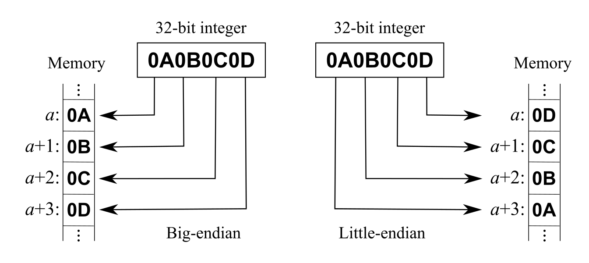

## About Parrot Pot

* [Parrot Pot](https://support.parrot.com/fr/support/produits/parrot-pot) are meant to keep your plants alive by monitoring their environment
* Has sensors to relay temperature, light intensity, soil temperature, soil moisture and fertility (via electrical conductivity)
* Has a water tank and a pump, and can water the plant automatically
* Uses Bluetooth Low Energy (BLE) and has a limited range
* 4 * AA batteries are used as power source

## Features

* Read real-time sensor values
* Read historical sensor values
* Temperature
* Light intensity
* Soil moisture
* Soil fertility
* Water tank
* Manual and automatic watering
* Notification LED
* IPX5

## Protocol

The device uses BLE GATT for communication.  
Sensor values are immediately available for reading, but the raw values need conversions.  
The device disconnects after about 1 second without an incoming request, so keep connections short and requests queued.  

### BLE & GATT

The basic technologies behind the sensors communication are [Bluetooth Low Energy (BLE)](https://en.wikipedia.org/wiki/Bluetooth_Low_Energy) and [GATT](https://www.bluetooth.com/specifications/gatt).
They allow the devices and the app to share data in a defined manner and define the way you can discover the devices and their services.
In general you have to know about services and characteristics to talk to a BLE device.



### Data structure

Bluetooth payload data typically uses little-endian byte order.  
This means that the data is represented with the least significant byte first.  

To understand multi-byte integer representation, you can read the [endianness](https://en.wikipedia.org/wiki/Endianness) Wikipedia page.

## Relationship with the Flower Power

The Parrot Pot is built on the [Flower Power](flowerpower-ble-api.md) firmware, and shares most of its BLE interface.
Everything not described here (history transfer, live mode, firmware update) works as documented there.

What differs:

| Topic                  | Flower Power                         | Parrot Pot                                         |
| ---------------------- | ------------------------------------ | -------------------------------------------------- |
| firmware project       | `hawaii`                             | `hawaii2`, on `kauai` hardware                     |
| watering service       | no                                   | `39e1f900`                                         |
| absolute clock         | no                                   | `39e1fd02`, unix time                              |
| plant doctor service   | firmware 2.0.3 only                  | yes, with 3 extra characteristics                  |
| extra characteristics  | -                                    | `39e1fa0f` - `39e1fa11`, `39e1fc07`                |
| force bond `39e1fe02`  | yes                                  | no                                                 |
| friendly name          | read/write                           | read only                                          |
| raw sunlight           | inverse power law, decreases with light | affine, increases with light                    |
| raw soil conductivity  | `0` without soil                     | about `2036` without soil, inverted scale          |
| advertisement          | 1 flags byte, no company id          | 3 bytes, company id `0x0043`                       |

**Raw values must never be carried over between the two devices without checking.**

## Identifying the device

The name advertised by the device is `Parrot pot AABB`, where `AABB` are the last 4 characters of the MAC address.

The name can be changed by the user through the `friendly name` characteristic, so it's safer to look for the service UUIDs instead:
* the live service (`39e1fa00`) is advertised by both the Pot and the Flower Power
* the watering service (`39e1f900`) is what identifies a Pot, once connected

## Services and characteristics

| Service               | UUID       | Purpose                                                  |
| --------------------- | ---------- | -------------------------------------------------------- |
| Generic access        | `1800`     | device name                                              |
| Device information    | `180a`     | firmware and hardware versions                           |
| Battery               | `180f`     | battery level                                            |
| Live                  | `39e1fa00` | current sensor values, live mode, LED                    |
| Upload                | `39e1fb00` | history file transfer                                    |
| History               | `39e1fc00` | history state, where to start a transfer                 |
| Clock                 | `39e1fd00` | device time, wall clock                                  |
| Plant doctor          | `39e1fd80` | plant profile                                            |
| Calibration           | `39e1fe00` | calibration data, friendly name, color                   |
| Watering              | `39e1f900` | water tank, manual and automatic watering                |
| OTA download          | `f000ffc0` | Texas Instruments firmware update                        |

Generic access, device information, battery, upload and OTA download are identical to the
[Flower Power](flowerpower-ble-api.md#services-and-characteristics), and are not repeated here.

##### Generic Access (UUID 00001800-0000-1000-8000-00805f9b34fb)

| Characteristic UUID                  | Access      | Type       | Description                   |
| ------------------------------------ | ----------- | ---------- | ----------------------------- |
| 00002a00-0000-1000-8000-00805f9b34fb | read        | ASCII      | device name                   |

##### Device Information (UUID 0000180a-0000-1000-8000-00805f9b34fb)

| Characteristic UUID                  | Access      | Type       | Description                   |
| ------------------------------------ | ----------- | ---------- | ----------------------------- |
| 00002a23-0000-1000-8000-00805f9b34fb | read        | bytes      | system ID                     |
| 00002a25-0000-1000-8000-00805f9b34fb | read        | ASCII      | serial number                 |
| 00002a26-0000-1000-8000-00805f9b34fb | read        | ASCII      | firmware revision, see [Firmware version](#firmware-version) |
| 00002a27-0000-1000-8000-00805f9b34fb | read        | ASCII      | hardware revision (bootloader version) |
| 00002a28-0000-1000-8000-00805f9b34fb | read        | ASCII      | software revision             |
| 00002a29-0000-1000-8000-00805f9b34fb | read        | ASCII      | manufacturer name             |

##### Battery service (UUID 0000180f-0000-1000-8000-00805f9b34fb)

| Characteristic UUID                  | Access      | Type       | Description                   |
| ------------------------------------ | ----------- | ---------- | ----------------------------- |
| 00002a19-0000-1000-8000-00805f9b34fb | read        | uint8      | battery level (%)             |

##### Live service (UUID 39e1fa00-84a8-11e2-afba-0002a5d5c51b)

| Characteristic UUID                  | Access      | Type       | Description                                  |
| ------------------------------------ | ----------- | ---------- | -------------------------------------------- |
| 39e1fa01-84a8-11e2-afba-0002a5d5c51b | read/notify | uint16     | sunlight (raw), see [Sunlight](#sunlight)    |
| 39e1fa02-84a8-11e2-afba-0002a5d5c51b | read/notify | uint16     | soil conductivity (raw)                      |
| 39e1fa03-84a8-11e2-afba-0002a5d5c51b | read/notify | uint16     | soil temperature (raw)                       |
| 39e1fa04-84a8-11e2-afba-0002a5d5c51b | read/notify | uint16     | air temperature (raw)                        |
| 39e1fa05-84a8-11e2-afba-0002a5d5c51b | read/notify | uint16     | soil moisture (raw)                          |
| 39e1fa06-84a8-11e2-afba-0002a5d5c51b | read/write  | uint8      | live measure period (s)                      |
| 39e1fa07-84a8-11e2-afba-0002a5d5c51b | read/write  | uint8      | LED status                                   |
| 39e1fa09-84a8-11e2-afba-0002a5d5c51b | read/notify | float32    | soil moisture, VWC (%) (calibrated)          |
| 39e1fa0a-84a8-11e2-afba-0002a5d5c51b | read/notify | float32    | air temperature (°C) (calibrated)            |
| 39e1fa0b-84a8-11e2-afba-0002a5d5c51b | read/notify | float32    | sunlight (calibrated), **do not use**, see [Sunlight](#sunlight) |
| 39e1fa0f-84a8-11e2-afba-0002a5d5c51b | read/notify | ?          | unknown, Pot only                            |
| 39e1fa10-84a8-11e2-afba-0002a5d5c51b | read/notify | ?          | unknown, Pot only                            |
| 39e1fa11-84a8-11e2-afba-0002a5d5c51b | read/notify | ?          | unknown, Pot only                            |

The calibrated `ea`, `ecb` and `ec porous` characteristics of the Flower Power (`39e1fa0c` to `39e1fa0e`) have not been observed.
There is no `39e1fa08` (last move date).

##### Upload service (UUID 39e1fb00-84a8-11e2-afba-0002a5d5c51b)

| Characteristic UUID                  | Access      | Type       | Description                          |
| ------------------------------------ | ----------- | ---------- | ------------------------------------ |
| 39e1fb01-84a8-11e2-afba-0002a5d5c51b | notify      | 20 bytes   | Tx buffer, history file frames       |
| 39e1fb02-84a8-11e2-afba-0002a5d5c51b | read/notify | uint8      | Tx status (device side)              |
| 39e1fb03-84a8-11e2-afba-0002a5d5c51b | read/write  | uint8      | Rx status (application side)         |
| 39e1fb04-84a8-11e2-afba-0002a5d5c51b | read/write  | ?          | upload file selector (not in the Parrot documentation) |

##### History service (UUID 39e1fc00-84a8-11e2-afba-0002a5d5c51b)

| Characteristic UUID                  | Access      | Type       | Description                          |
| ------------------------------------ | ----------- | ---------- | ------------------------------------ |
| 39e1fc01-84a8-11e2-afba-0002a5d5c51b | read        | uint16     | number of entries                    |
| 39e1fc02-84a8-11e2-afba-0002a5d5c51b | read        | uint32     | last entry index                     |
| 39e1fc03-84a8-11e2-afba-0002a5d5c51b | read/write  | uint32     | transfer start index                 |
| 39e1fc04-84a8-11e2-afba-0002a5d5c51b | read        | uint16     | current session id                   |
| 39e1fc05-84a8-11e2-afba-0002a5d5c51b | read        | uint32     | current session start index          |
| 39e1fc06-84a8-11e2-afba-0002a5d5c51b | read        | uint16     | current session period (s)           |
| 39e1fc07-84a8-11e2-afba-0002a5d5c51b | read        | uint8      | unknown, Pot only, `0x00` and `0x02` observed |

##### Clock service (UUID 39e1fd00-84a8-11e2-afba-0002a5d5c51b)

| Characteristic UUID                  | Access      | Type       | Description                          |
| ------------------------------------ | ----------- | ---------- | ------------------------------------ |
| 39e1fd01-84a8-11e2-afba-0002a5d5c51b | read        | uint32     | seconds since device boot            |
| 39e1fd02-84a8-11e2-afba-0002a5d5c51b | read/write  | uint32     | wall clock, unix time                |

See [Device time](#device-time).

##### Plant doctor service (UUID 39e1fd80-84a8-11e2-afba-0002a5d5c51b)

| Characteristic UUID                  | Access      | Type       | Description                          |
| ------------------------------------ | ----------- | ---------- | ------------------------------------ |
| 39e1fd81-84a8-11e2-afba-0002a5d5c51b | read/write  | uint16     | plant profile, unknown unit          |
| 39e1fd82-84a8-11e2-afba-0002a5d5c51b | read/write  | uint16     | unknown, always `0`                  |
| 39e1fd83-84a8-11e2-afba-0002a5d5c51b | read/write  | uint16     | plant reference soil moisture (0.1 % VWC) |
| 39e1fd84-84a8-11e2-afba-0002a5d5c51b | read/write  | uint16     | unknown, always `288`                |
| 39e1fd85-84a8-11e2-afba-0002a5d5c51b | read/write  | uint16     | plant profile, unknown unit          |
| 39e1fd86-84a8-11e2-afba-0002a5d5c51b | read/notify | uint8      | unknown, alert flags?                |
| 39e1fd87-84a8-11e2-afba-0002a5d5c51b | read/notify | uint32     | unknown, unix time, Pot only         |
| 39e1fd88-84a8-11e2-afba-0002a5d5c51b | read/notify | uint32     | unknown, unix time, Pot only         |
| 39e1fd89-84a8-11e2-afba-0002a5d5c51b | read/notify | uint32     | unknown, Pot only                    |

See [Plant profile](#plant-profile).

##### Calibration service (UUID 39e1fe00-84a8-11e2-afba-0002a5d5c51b)

| Characteristic UUID                  | Access      | Type       | Description                          |
| ------------------------------------ | ----------- | ---------- | ------------------------------------ |
| 39e1fe01-84a8-11e2-afba-0002a5d5c51b | read        | uint16[]   | calibration data                     |
| 39e1fe03-84a8-11e2-afba-0002a5d5c51b | read        | 19 bytes   | friendly name                        |
| 39e1fe04-84a8-11e2-afba-0002a5d5c51b | read        | uint16     | color                                |
| 39e1fe05-84a8-11e2-afba-0002a5d5c51b | read        | uint8      | unknown, `0x11` observed             |
| 39e1fe06-84a8-11e2-afba-0002a5d5c51b | read/write  | uint8      | unknown, `0x00` observed             |

See [Friendly name and color](flowerpower-ble-api.md#friendly-name-and-color) for the formats.

##### Watering service (UUID 39e1f900-84a8-11e2-afba-0002a5d5c51b)

| Characteristic UUID                  | Access      | Type       | Description                          |
| ------------------------------------ | ----------- | ---------- | ------------------------------------ |
| 39e1f901-84a8-11e2-afba-0002a5d5c51b | read/write  | uint16     | unknown, derived from the plant profile and settings |
| 39e1f902-84a8-11e2-afba-0002a5d5c51b | read/write  | uint16     | unknown, derived from the plant profile |
| 39e1f903-84a8-11e2-afba-0002a5d5c51b | read/write  | uint16     | automatic watering, trigger threshold (0.1 % VWC) |
| 39e1f904-84a8-11e2-afba-0002a5d5c51b | read/write  | uint16     | automatic watering, target (0.1 % VWC) |
| 39e1f905-84a8-11e2-afba-0002a5d5c51b | read/write  | uint16     | automatic watering, delay (15 minutes) |
| 39e1f906-84a8-11e2-afba-0002a5d5c51b | write       | uint16     | manual watering trigger              |
| 39e1f907-84a8-11e2-afba-0002a5d5c51b | read/notify | uint8      | water tank level (%)                 |
| 39e1f908-84a8-11e2-afba-0002a5d5c51b | read/write  | uint8      | unknown                              |
| 39e1f90a-84a8-11e2-afba-0002a5d5c51b | read/write  | uint16     | unknown, always `0`                  |
| 39e1f90b-84a8-11e2-afba-0002a5d5c51b | read/write  | uint16     | unknown, always `0`                  |
| 39e1f90c-84a8-11e2-afba-0002a5d5c51b | read/write  | uint16     | unknown, always `0`                  |
| 39e1f90d-84a8-11e2-afba-0002a5d5c51b | read/write  | uint8      | automatic watering enable            |
| 39e1f90e-84a8-11e2-afba-0002a5d5c51b | read/write  | uint16     | unknown, always `0`                  |
| 39e1f90f-84a8-11e2-afba-0002a5d5c51b | read/write  | uint16     | unknown, always `1440`               |
| 39e1f910-84a8-11e2-afba-0002a5d5c51b | read/write  | uint32     | unknown, always `0`                  |
| 39e1f911-84a8-11e2-afba-0002a5d5c51b | read/write  | uint32     | unknown, always `0`                  |
| 39e1f912-84a8-11e2-afba-0002a5d5c51b | read/write  | uint8      | unknown enum, **not** the watering mode |
| 39e1f913-84a8-11e2-afba-0002a5d5c51b | read/notify | uint16     | unknown, tracks the battery          |

The watering service is entirely undocumented by Parrot, and absent from every other known reverse engineering project.
The characteristic list comes from [2], the rest from captures [5]. See [Watering](#watering).

## Firmware version

The firmware revision string (`2a26`) has the same `<date>_<project>-<version>_<config>` layout as on the
[Flower Power](flowerpower-ble-api.md#firmware-version), and the version is extracted the same way.

The project name is the only reliable way to tell the two apart: the Pot is `hawaii2` on `kauai` hardware.
Observed values:

```
2016-07-08_hawaii2-0.29.1_kauai-protoB
2016-10-13_hawaii2-1.2.0_kauai-protoB
```

The hardware revision string (`2a27`) read `2014-12-09_dev-kauai-protoA_kauai-protoA` on both.
A `*_hawaii-*_hardware-config-MP.bin` OAD image is a Flower Power firmware, and contains no watering service at all.

## Reading data

Device name, battery, LED, live mode and friendly name work as on the [Flower Power](flowerpower-ble-api.md#reading-data).

### Real time data

| Measurement        | Read from               | Conversion                                        |
| ------------------ | ----------------------- | ------------------------------------------------- |
| sunlight           | `39e1fa01` (raw)        | `lux = max(0, 22.06 * raw - 73.5)`, see [Sunlight](#sunlight) |
| soil moisture      | `39e1fa09` (calibrated) | `float32`, % VWC                                  |
| air temperature    | `39e1fa0a` (calibrated) | `float32`, °C                                     |
| soil temperature   | `39e1fa03` (raw)        | Flower Power [formula](flowerpower-ble-api.md#real-time-data) |
| soil conductivity  | `39e1fa02` (raw)        | unknown, see below                                |

The raw soil moisture and air temperature (`39e1fa05`, `39e1fa04`) can use the Flower Power formulas,
but the calibrated values are better.

Soil conductivity: the raw scale is **inverted** compared to the Flower Power.
It reads about `2036` without soil (a Flower Power in air reads `0`), and the lowest value observed is about `1747`.
No conversion has been established.

### Sunlight

Read sunlight from the **raw** characteristic (`39e1fa01`). It is affine in illuminance, and matches the lux figure of the official application:

```
lux = 22.06 * raw - 73.5        // clamp to 0
```

| Condition          | app (lux) | 39e1fa01 | formula | error |
| ------------------ | --------- | -------- | ------- | ----- |
| sensor obstructed  | 0         | 3        | 0       | 0     |
| indoors, at a wall | 1385      | 67       | 1405    | +20   |
| indoors, at a desk | 2500      | 115      | 2464    | -36   |
| indoors, at a desk | 2550      | 120      | 2574    | +24   |

The fit was made without the dark point, yet crosses zero at a raw value of `3.3` against a measured `3` with the sensor covered.
Residuals stay within ±36 lux over the range tested.

Caveats:

* the slope was calibrated on a single device, under indoor daylight; the sensor measures PAR, so an artificial light source would read differently
* the raw scale is unrelated to the Flower Power's, where a larger raw value means *less* light

Do **not** use the calibrated sunlight (`39e1fa0b`). It is usually described as a daily light integral, and converted with
`lux = dli * 11.574 * 53.93`, but on this device:

* it is **not** a daily integral: it dropped from `0.549` to `0.100` and rose back to `0.295` within half an hour as the sensor was covered and moved
* it is **not** linear in illuminance: against the application it gives `7087`, `4902` and `1912` lux per unit over three segments,
  roughly `lux = 4830 * (fa0b - 0.1)^0.77`
* it **floors at `0.1`** with the sensor fully obstructed, so any multiplicative conversion reports light in complete darkness

### Water tank

The water tank level (`39e1f907`) is a `uint8` percentage. The tank capacity is 2.2 L.

The reading is noisy: `70`, `72`, `60` and `61` were read over 25 minutes on a Pot that was not watering.
Smooth it, or read it several times, rather than trusting a single sample.

### Device time

The current time (`39e1fd01`) is a `uint32`: seconds since the device booted, as on the [Flower Power](flowerpower-ble-api.md#device-time).

The Pot also has an absolute clock (`39e1fd02`), a read/write `uint32` unix timestamp.
It advances at the same rate as `39e1fd01`, so it can be used directly instead of a wall time offset.

| Bytes | Type      | Example       | Description                       |
| ----- | --------- | ------------- | --------------------------------- |
| 00-03 | uint32    | `17 c9 69 6a` | 1785317655, 2026-07-29 09:34:15 UTC |

It holds whatever the application last wrote, so it is only as trustworthy as the phone that set it.
It reads `0` on a device that has never been paired.

## Historical data

Identical to the Flower Power, see [Historical data](flowerpower-ble-api.md#historical-data).
The history entry layout is unknown on both devices.

## Watering

### Manual watering

Write to the manual watering trigger (`39e1f906`) to run the pump once.
WatchFlower writes the bytes `08 00`; the meaning of the value is unknown (a dose, a pump run time, or an index into a table of doses).

### Automatic watering

The device waters on its own using four settings:

| Characteristic | Type      | Unit       | Description                                                       |
| -------------- | --------- | ---------- | ----------------------------------------------------------------- |
| `39e1f90d`     | uint8     | -          | `0` = automatic watering off, `1` = on                            |
| `39e1f903`     | uint16    | 0.1 % VWC  | trigger threshold: water when the soil moisture drops below this  |
| `39e1f904`     | uint16    | 0.1 % VWC  | target: stop watering once the soil moisture reaches this         |
| `39e1f905`     | uint16    | 15 minutes | delay, `0` = disabled                                             |

Both soil moisture bounds use the same quantity as the calibrated soil moisture (`39e1fa09`), in tenths of a percent.
For example a 40 % trigger and a 54 % target are written as:

| Characteristic | Bytes   | Value | Meaning     |
| -------------- | ------- | ----- | ----------- |
| `39e1f903`     | `90 01` | 400   | 40.0 % VWC  |
| `39e1f904`     | `1c 02` | 540   | 54.0 % VWC  |

The mapping holds over the whole range the application allows (5 % to 100 %).
When automatic watering is disabled, both bounds keep their previous values. The factory defaults are `250` (25.0 %) and `300` (30.0 %).

The delay counts quarter hours (96 per day):

| Application setting | `39e1f905` | Decoded             |
| ------------------- | ---------- | ------------------- |
| disabled            | 0          | -                   |
| "around 2 days"     | 192        | 48 h                |
| "around 7 days"     | 668        | 167 h (6 days 23 h) |

What the delay gates (a minimum interval between two waterings, or a grace period after the threshold is crossed) is unknown.

### Watering modes

The official application offers four modes, but they only exist in the application: it translates each one into the settings above.

| Application mode | `39e1f90d` | `39e1f903` | `39e1f904` | `39e1f905` |
| ---------------- | ---------- | ---------- | ---------- | ---------- |
| manual           | 0          | *unused*   | *unused*   | 0          |
| perfect drop     | 1          | ref        | ref + 60   | 0          |
| plant sitter     | 1          | ref - 60   | ref        | 0          |
| custom           | 1          | user       | user       | user       |

`ref` is the plant reference soil moisture (`39e1fd83`), see [Plant profile](#plant-profile).
"Perfect drop" and "plant sitter" are a 6.0 % wide band above or below it, so a client can reproduce both modes without the plant database.

The mode cannot be read back from the device:

* assigning a plant rewrites `39e1f903` and `39e1f904` to the perfect drop band, even in manual mode
* `39e1f912` does not identify the mode either, see [Open questions](#open-questions)

## Plant profile

The application writes a plant profile into the plant doctor service whenever the plant assigned to the Pot changes.
Only `39e1fd81`, `39e1fd83` and `39e1fd85` depend on the plant, and the profile is deterministic: assigning the same plant again reproduces the same values.

| Plant assigned in the app | fd81 | fd82 | fd83 | fd84 | fd85 |
| ------------------------- | ---- | ---- | ---- | ---- | ---- |
| *none* (default profile)  | 886  | 0    | 380  | 288  | 810  |
| Aloe vera                 | 482  | 0    | 290  | 288  | 480  |
| Peace lily                | 898  | 0    | 380  | 288  | 990  |
| Aloe vera again           | 482  | 0    | 290  | 288  | 480  |
| *none* again              | 886  | 0    | 380  | 288  | 810  |
| Papyrus                   | 868  | 0    | 410  | 288  | 990  |

These values did not move over twenty minutes of captures while the soil moisture and uptime changed, so there is no live component.

A Pot that has never been given a plant uses the default profile, so it looks configured rather than empty.

`39e1fd83` is the **reference soil moisture**, in tenths of a percent VWC. It is what the watering modes are anchored on,
and its ordering matches how thirsty the plants are:

| Aloe vera | another device's plant | default / peace lily | Papyrus |
| --------- | ---------------------- | -------------------- | ------- |
| 29.0 %    | 32.0 %                 | 38.0 %               | 41.0 %  |

The service is named after the `PLANT_DOCTOR_EVENT_PROCESS_NOTIFY` debug string of the Flower Power `2.0.3` firmware,
which contains `39e1fd80` to `39e1fd86`. A Flower Power running `1.0.0` does not expose it.

## Advertisement data

The Pot advertises manufacturer data with company identifier `0x0043`, 3 bytes long:

| Bytes | Type  | Observed values                  | Description        |
| ----- | ----- | -------------------------------- | ------------------ |
| 00    | uint8 | `0x01`                           | constant so far    |
| 01    | uint8 | `0x23`, `0x33`                   | unknown            |
| 02    | uint8 | `0x01`, `0x20`, `0x21`, `0x22`   | flags              |

Byte 02 changed between two advertisements of the same device fifteen seconds apart,
which makes it the flags byte by analogy with the [Flower Power](flowerpower-ble-api.md#advertisement-data).
Which bits mean `unread entries`, `move detected` or `starting` on the Pot, if any, is unknown.

## Open questions

Nothing in the watering feature depends on the characteristics below.
Their units are probably out of reach from captures alone, as the application never displays a number for them, only a coarse "droplet" rating.
Decompiling the application, or recovering its plant database, is the way forward.

**`39e1fd81` and `39e1fd85`** are per-plant, with an unknown unit. They are not the two bounds of a range
(the sign of `fd81 - fd85` flips between plants: `+76`, `+2`, `-92`, `-122`), and do not follow the soil moisture
(the default profile and the peace lily share `fd83 = 380` but differ on both).
`fd85` read exactly `990` for the two wettest plants, which hints at a cap on a `0` - `1000` scale.

**`39e1fd86`** reads `0x01` or `0x0d` with no identified trigger, which would fit a set of active alert flags.

**`39e1f901` and `39e1f902`** are rewritten with the plant profile, and reproduce the same values when the same plant is assigned again:

| Plant assigned in the app | f901 | f902 |
| ------------------------- | ---- | ---- |
| *none* (default profile)  | 1380 | 0    |
| Aloe vera                 | 1413 | 89   |
| Peace lily                | 232  | 1420 |
| Aloe vera again           | 1413 | 89   |
| *none* again              | 1380 | 0    |
| Papyrus                   | 8461 | 9440 |

* `39e1f902` looks purely plant derived: `0` without a plant, non-zero for every real plant
* `39e1f901` also depends on the settings: without a plant, it read `1142`, `1581`, `1255`, `1427`, `1437` and `1381` as the watering bounds were changed,
  yet it is not a function of the bounds alone (peace lily and default profile share the same band, but read `232` and `1380`), and it drifted by one between two identical captures

No monotonic reading of the pair works: peace lily and Aloe vera look like an interval and a dose swapping places, but papyrus is six times larger on both.

**`39e1f912`** is an enum reading `0`, `1` or `2`, and does not track the watering mode:
manual and plant sitter both read `2`, custom and perfect drop both read `0`,
and a device running `1.2.0` read `1` with perfect drop bounds. A client does not need to write it, and should not read it as a mode.

**`39e1f913`** tracks the battery, consistent with a supply voltage, but on an unknown scale and not in lockstep:

| battery (`2a19`) | 97 % | 91 % | 90 %     | 89 % | 88 % |
| ---------------- | ---- | ---- | -------- | ---- | ---- |
| `39e1f913`       | 294  | 275  | 270, 269 | 266  | 266  |

**`39e1f910` and `39e1f911`** read `0` in every capture, including after the Pot had watered many times, manually and automatically.
They are not a last watering timestamp or a watering counter.

**`39e1f90a` - `39e1f90c`, `39e1f90e`** read `0` in every capture and never moved. **`39e1f90f`** always reads `1440`, the number of minutes in a day.

Also unknown:

* the value written to the manual watering trigger (`39e1f906`)
* what the automatic watering delay gates
* `39e1fa0f` - `39e1fa11`, `39e1fc07`, `39e1fd87` - `39e1fd89`, `39e1f908`, `39e1fe05`, `39e1fe06`
* the raw soil conductivity conversion
* the advertisement bytes 01 and 02
* history entry layout, and how to clear entries

## Reference

[1] https://developer.parrot.com/docs/FlowerPower/FlowerPower-BLE.pdf  
[2] https://github.com/grover/homebridge-flower-sensor  
[3] https://github.com/sandeepmistry/node-flower-power (upload, OAD and live mode implementations)  
[4] https://github.com/tazounet/parrot_flower_plugin (Domoticz plugin, calibrated characteristics)  
[5] toolBLEx captures of a `Parrot pot 9ad9` running `hawaii2-0.29.1`, taken in every watering mode the official application offers — manual, perfect drop, plant sitter, and custom with a 54 % target / 40 % trigger / no delay, a 100 % target / 5 % trigger / ~7 day delay, and a 15 % target / 10 % trigger / ~2 day delay — plus a plant assignment series (no plant, Aloe vera, peace lily, Aloe vera again, no plant again, papyrus) with every other variable held fixed  

## License

MIT
